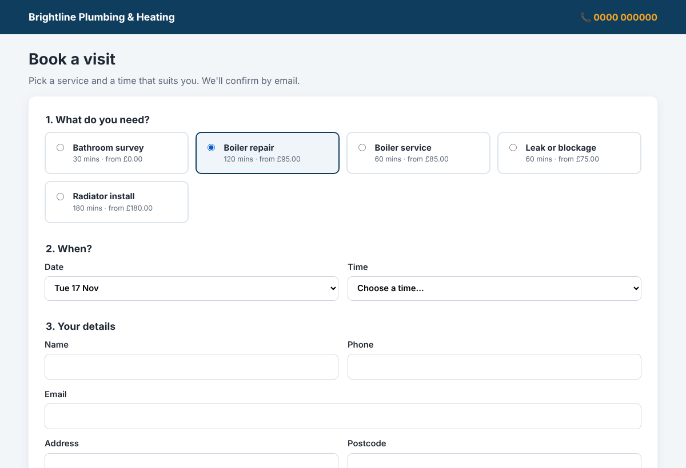
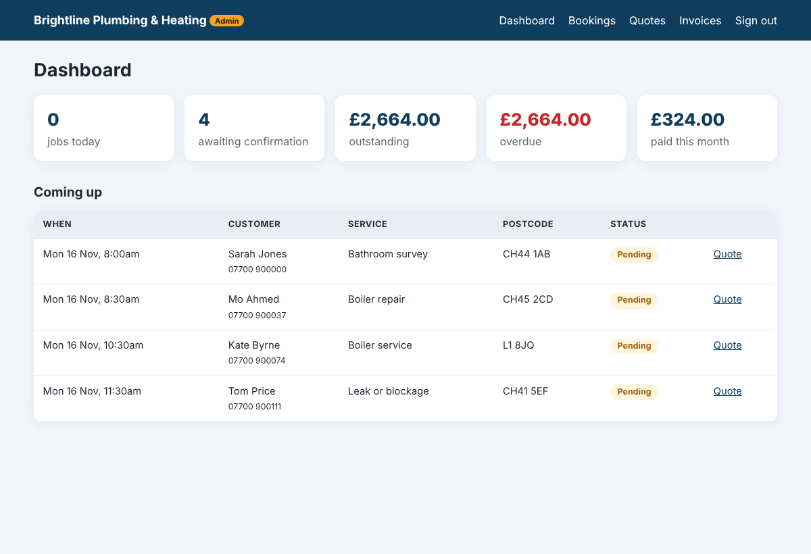
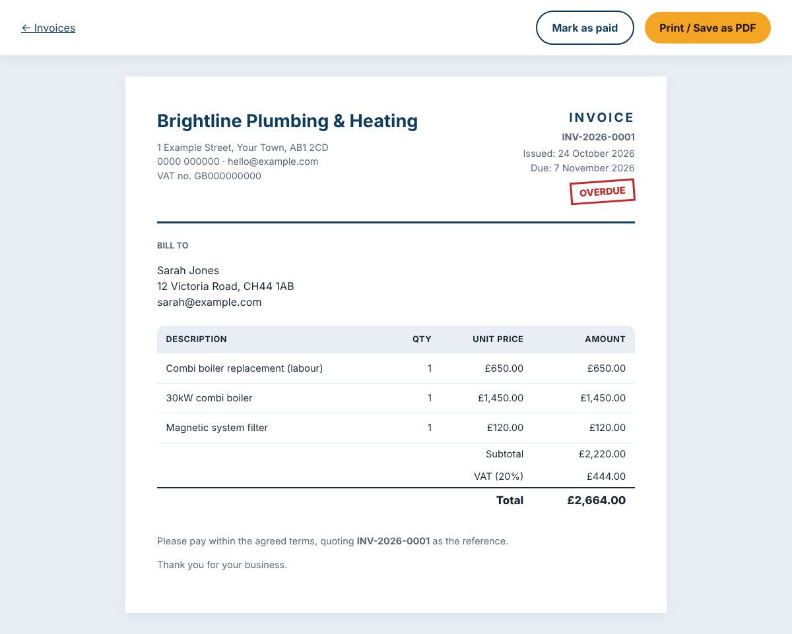

# Trades Booking System


Online booking, quotes and invoicing for tradespeople: plumbers, electricians, heating engineers and cleaners. Customers book a visit from live availability. The business owner manages jobs, turns them into quotes, and sends VAT invoices from one admin panel.

It's written in **plain modern PHP 8.2 with PDO**: no framework and no runtime dependencies, so it runs on almost any shared host. It works with **MySQL** or **SQLite**.

I built it because the small trade businesses I make websites for at [Wallasey WebWorks](https://wallaseywebworks.co.uk) keep asking for the same thing: "let customers book online, and help me get paid".

| Customer booking | Admin dashboard |
|---|---|
|  |  |



## Features

**For customers**
- Choose a service, then pick from **live time slots** that load as soon as a day is chosen.
- Clear validation messages, UK postcode formatting and a booking reference on confirmation.

**For the business**
- **Dashboard:** today's jobs, bookings waiting for confirmation, money outstanding, overdue and paid this month.
- **Bookings:** filter by status, then confirm, complete or cancel in one click. Start a quote straight from a booking.
- **Quotes:** line items, VAT, and draft → sent → accepted/declined.
- **Invoices:** created from accepted quotes, numbered in sequence (`INV-2026-0001`) with payment terms. Overdue invoices are flagged, and each invoice has a **print-ready page you can save as a PDF**.

**Scheduling rules**
- Opening hours for each weekday, a slot interval, minimum notice and how far ahead customers can book.
- Each job's length comes from its service, and a job can't run past closing time.
- **No double bookings:** slots that overlap existing jobs are hidden, and availability is checked again inside a database transaction when the customer submits.
- Supports more than one engineer: set `engineers` to allow jobs to overlap.

## Security

- **CSRF tokens** on every form, compared in constant time.
- **Prepared statements** everywhere, so there's no SQL built from user input.
- Every template value goes through `e()` (**HTML escaping**). A strict **Content-Security-Policy** allows no inline scripts.
- Passwords hashed with `password_hash()` and rehashed automatically when PHP's default algorithm changes.
- **Login lockout** after 5 failed attempts. Unknown emails take the same time to check as real ones, so attackers can't use timing to find accounts.
- Session cookies are HttpOnly and SameSite=Lax, and the session id is regenerated at login.
- **Post/Redirect/Get** after every form, so refreshing a page can't submit it twice.
- Money is stored as **integer pence**, never floats.

## Getting started

```bash
git clone https://github.com/volaitan/trades-booking-system.git
cd trades-booking-system
cp .env.example .env            # business name, database, VAT number
php bin/setup.php --email=you@example.com --name="Your Name" --password="a-long-password" --demo
php -S localhost:8080 -t public public/index.php
```

- Customer booking page: http://localhost:8080
- Admin: http://localhost:8080/admin

`--demo` adds sample bookings, quotes and invoices. Leave it off for a clean install.

**With Docker and MySQL:**

```bash
docker compose up -d --build
docker compose exec app php bin/setup.php --email=you@example.com --password="a-long-password" --demo
```

**Tests:**

```bash
composer install
composer test
```

## Configuration

Business details and database settings are read from `.env`. Booking rules are set in [`config.php`](config.php):

```php
'opening_hours'    => [1 => ['08:00', '17:00'], /* … */ 6 => ['09:00', '13:00']],
'slot_minutes'     => 30,
'min_notice_hours' => 24,
'max_days_ahead'   => 60,
'engineers'        => 1,
```

## Architecture

```
public/index.php          Front controller: session, security headers, routes
src/
├── App.php               Builds the services (a small hand-written container)
├── Router.php            Pattern routes such as /admin/quotes/{id}
├── Controllers/          PublicController (booking), AdminController
├── Services/
│   ├── AvailabilityService.php   Slot calculation and overlap detection
│   ├── BookingService.php        Validation and transactional booking
│   ├── QuoteCalculator.php       Line totals and VAT in pence
│   └── InvoiceService.php        Quote → invoice, numbering, overdue, summaries
├── Repositories/         SQL for bookings, services and quotes
├── Auth.php · Csrf.php · Money.php · View.php
templates/                Plain PHP templates; all output escaped
database/                 schema.sqlite.sql and schema.mysql.sql
tests/                    30 PHPUnit tests on in-memory SQLite
```

Business logic lives in services that take the current time as a parameter. This lets the tests check scheduling rules exactly, for example "it's Monday 10:00 with 24 hours' notice, so Tuesday starts at 10:00".

CI runs the PHPUnit suite on PHP 8.2 and 8.3, plus an integration job that installs the schema and demo data on a real **MySQL 8** server.

## Roadmap

- Email confirmations and reminders (PHPMailer or SMTP)
- Online card payments on invoices (Stripe)
- Customer self-service links to reschedule or cancel

## Licence

MIT
